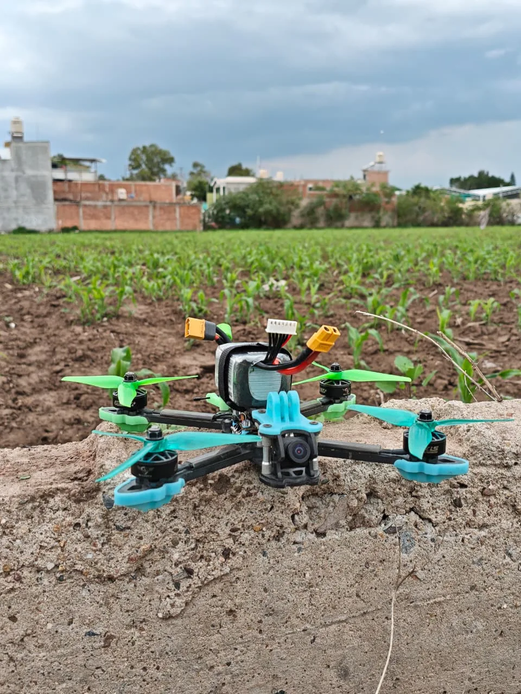
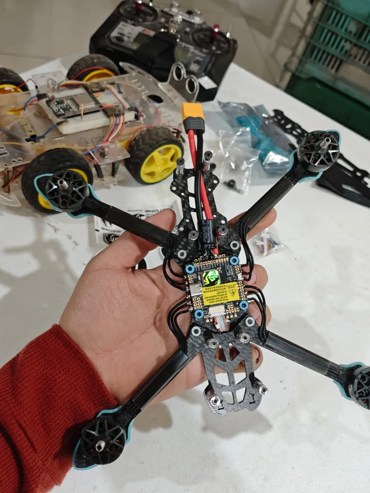
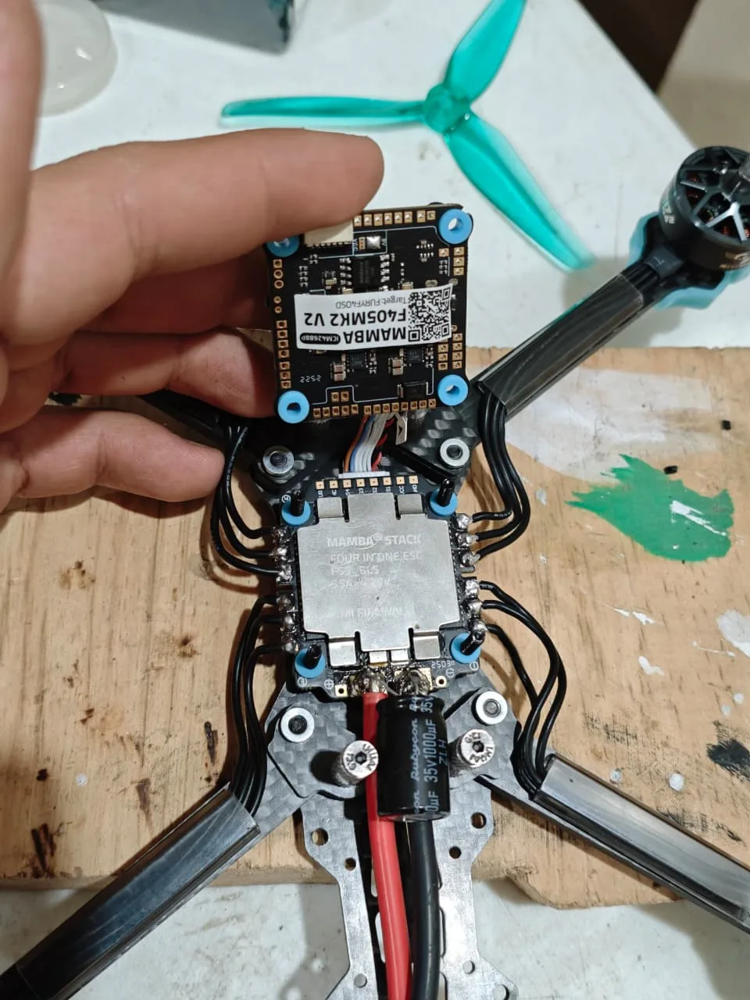
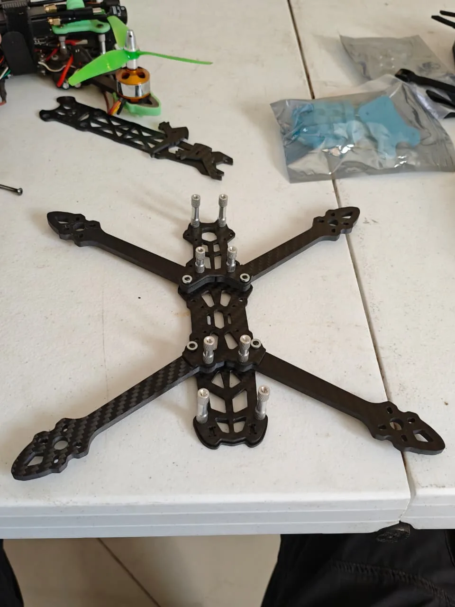
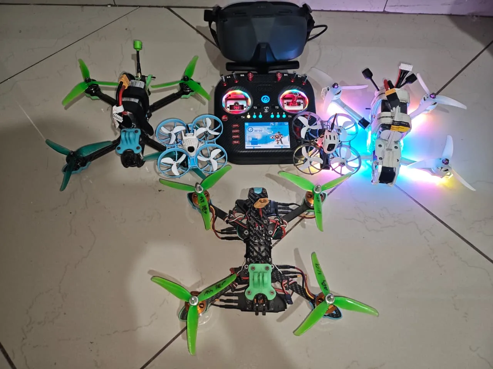
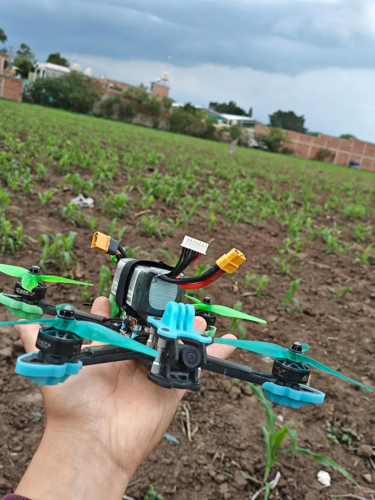

# Dron FPV — Ensamblaje y configuración con Betaflight

Proyecto personal de **Juan Emmanuel Rosales Fernández**, estudiante de Ingeniería Informática en el Instituto Tecnológico Superior de Irapuato. Documenta el montaje de un **dron FPV (First Person View)** con controladora de vuelo, ESC, motores, sistema de radio y cámara para vuelo en primera persona.

El proyecto nació después de un primer intento en enero de 2024 de controlar un dron con ESP32; conseguí mover los motores, pero **no logré estabilizar el prototipo mediante PID**. Tiempo después, con orientación de un compañero universitario, armé un dron con componentes especializados, lo configuré mediante **Betaflight** y llegué a volarlo. La fecha exacta de finalización del dron funcional no está confirmada.

## Objetivos

- Aprender cómo se integran los sistemas mecánicos, eléctricos y electrónicos de un cuadricóptero.
- Comprender conexiones de motores, ESC, controladora de vuelo, radio y video.
- Configurar un dron real con Betaflight para el control de vuelo.
- Documentar el aprendizaje mediante fotografías auténticas del montaje.

## Herramientas y tecnologías

| Tecnología / componente | Función en el proyecto |
| --- | --- |
| Betaflight Configurator | Configuración de la controladora de vuelo |
| Controladora de vuelo | Gestión de sensores y estabilización a través del firmware |
| ESC | Control de los motores brushless |
| Radio y receptor | Enlace de control remoto |
| Cámara y equipo FPV | Visualización en primera persona |
| Montaje electrónico | Conexiones, integración y mantenimiento |

**Nota:** las marcas, modelos, protocolos y versiones de firmware específicos no se consignan porque no se han confirmado. No se presenta un código original escrito para Betaflight.

## Proceso documentado

1. **Primer prototipo con ESP32 (enero de 2024):** intenté controlar un dron y aprendí acerca de las dificultades para estabilizarlo con un controlador PID. Ese prototipo no alcanzó vuelo estable.
2. **Integración de hardware especializado:** cambié a una arquitectura de dron FPV con controladora de vuelo y ESC, montaje de motores y distribución eléctrica.
3. **Configuración del sistema:** utilicé Betaflight para preparar la controladora del dron funcional.
4. **Pruebas:** realicé vuelos con el dron terminado.

## Galería de fotografías reales

| Componentes durante el ensamblaje | Controladora y conexiones |
| --- | --- |
|  |  |

| Estructura del dron | Equipo de radio y FPV |
| --- | --- |
|  |  |

## Configuración Betaflight

La controladora fue configurada usando **Betaflight**, pero el respaldo real de los ajustes **todavía no está incluido** en este repositorio. No se inventan valores de PID, Rates, UART, receptor ni Failsafe.

Si se desea incorporar la configuración original, consultar [`configuracion/README.md`](configuracion/README.md). El archivo de respaldo solo debe asociarse a la **versión exacta de Betaflight y la placa** de la que se exportó. Una configuración de otro dron no debe cargarse automáticamente.

## Alcance del repositorio

Este repositorio es una **documentación de hardware**, no una aplicación ejecutable y no contiene el código fuente de Betaflight. El firmware Betaflight pertenece a sus respectivos desarrolladores y se obtiene de sus canales oficiales.

## Autor

**Juan Emmanuel Rosales Fernández**  
Ingeniería Informática · Instituto Tecnológico Superior de Irapuato  
[Portafolio profesional](https://brocoly7w7.github.io/portafolio-juan-emmanuel/) · [GitHub](https://github.com/Brocoly7w7)

## Configuración de Betaflight

El dron fue configurado utilizando Betaflight 4.5.2
con una controladora SpeedyBee F405 V5.

Características:
- Control de motores mediante DSHOT300.
- Telemetría y visualización OSD.
- Configuración de GPS Rescue.
- Configuración de iluminación LED.

[Ver configuración de Betaflight](config/Betaflight_diff_publico.txt)

Nota: Este archivo documenta la configuración del
proyecto y no debe restaurarse sin comprobar la
compatibilidad del hardware y firmware.
